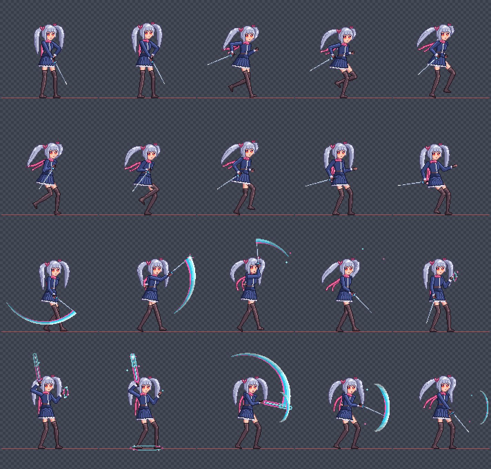
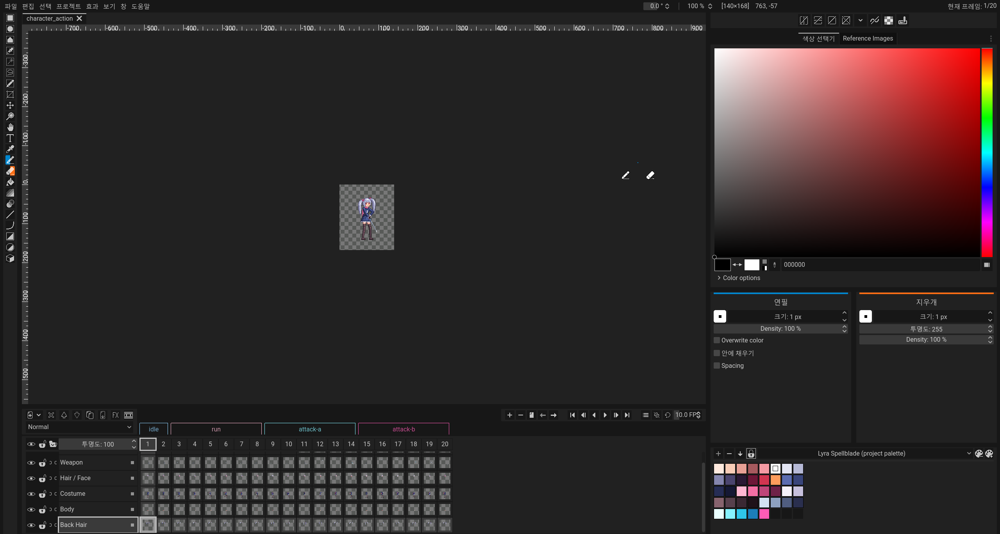
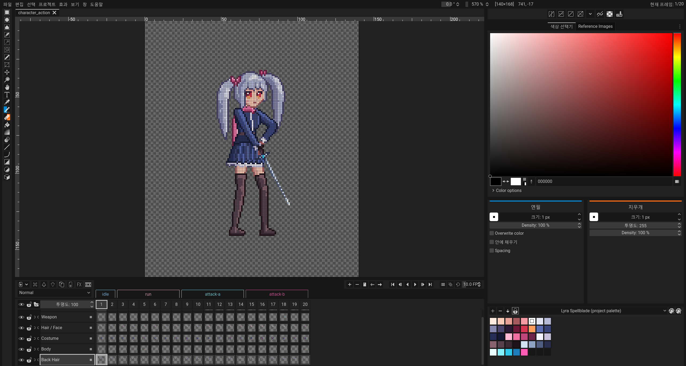
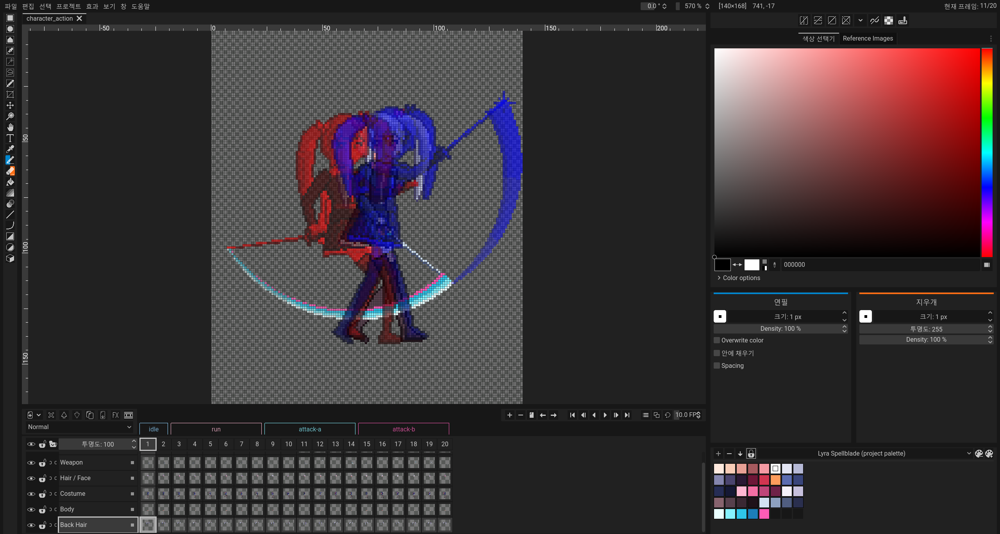

# Lyra · Silver Twin-tail Spellblade

**[▶ 라이브 미리보기 (GitHub Pages)](https://legerdo.github.io/lyra-spellblade-pixel-sprite/)**

서브컬처 판타지 미소녀 마법검사 픽셀 캐릭터와 액션 애니메이션입니다. [Pixelorama](https://github.com/Orama-Interactive/Pixelorama) v1.2.3-stable로 프로젝트를 만들고 export했으며, 게임에 바로 쓸 수 있는 투명 배경 스프라이트로 정리했습니다.



<sub>2× nearest-neighbour. 행 순서: Idle 0–1 · Run 0–2 / Run 3–5 · Attack A 0–1 / Attack A 2–5 · Attack B 0 / Attack B 1–5. 빨간 선은 지면(y = 140)입니다.</sub>

## 사양

| 항목 | 값 |
| --- | --- |
| 프레임 캔버스 | 140 × 168 px (모든 프레임 동일) |
| 캐릭터 영역 | 약 80 × 112 px, 발 기준선 y = 140, 3/4 시점 우향 |
| 프레임 | 20 (Idle 2 · Run 6 · Attack A 6 · Attack B 6) |
| 레이어 | Back Hair · Body · Costume · Hair / Face · Weapon · FX |
| 팔레트 | 37색 프로젝트 팔레트 “Lyra Spellblade” |
| 투명도 | 캐릭터 본체는 완전 불투명 / 완전 투명만 사용, 마법 FX만 3단계 alpha |

| 애니메이션 | Pixelorama 태그 | 프레임 | 시간 | 재생 |
| --- | --- | --- | --- | --- |
| Idle | `idle` | 1–2 | 500 ms | loop |
| Run | `run` | 3–8 | 90 ms | loop |
| Attack A · 상승 베기 | `attack-a` | 9–14 | 100 ms | one-shot |
| Attack B · 마법 검파 | `attack-b` | 15–20 | 100 ms | one-shot |

## 파일

```
index.html                       브라우저 미리보기 (외부 CDN/네트워크 의존 없음)
character_action.pxo             Pixelorama 원본 프로젝트 (레이어·태그·프레임 시간·팔레트 포함)
exports/character_action.png     스프라이트시트 700 × 672, 5열 × 4행, 타임라인 순서
exports/frames/                  개별 프레임 PNG 20장 (character_action_0001 … 0020)
exports/character_action.meta.json  프레임 순서·좌표·애니메이션 시간 메타데이터
qa/verification.json             자동 검증 결과
docs/images/                     Pixelorama 실제 화면·브라우저 캡처
authoring/                       제작·검증에 사용한 스크립트와 픽셀 템플릿
```

### 게임 엔진에서 쓰기

스프라이트시트의 프레임 `i`(0부터)는 `x = (i % 5) × 140`, `y = floor(i / 5) × 168`에 있습니다. 순서는 Idle 0–1, Run 0–5, Attack A 0–5, Attack B 0–5입니다. 피벗은 발 기준 `(70, 140)`을 권장합니다. 확대할 때는 nearest-neighbour 필터만 사용하세요.

## 제작 방식

- 얼굴, 눈, 앞머리, 리본은 픽셀 단위로 직접 배치한 템플릿(`authoring/art/`)입니다. 모든 프레임에서 같은 얼굴이 유지됩니다.
- 몸은 길이가 고정된 뼈대와 2-bone IK로 매 프레임 새로 그립니다. 팔, 다리, 몸통, 부츠, 검의 길이는 프레임마다 변하지 않습니다. 포즈는 key pose → breakdown 순서로 관절 좌표를 지정했습니다(`authoring/poses.py`).
- 외곽선은 selective outline입니다. 소재마다 한 단계 어두운 색을 쓰고, 순수 검정은 쓰지 않습니다. 명암은 2–3단계 cel shading입니다.
- 트윈테일, 스카프, 스커트는 구동 신호를 마디마다 늦게 받습니다. 그래서 몸보다 늦게 반응하는 follow-through가 생깁니다.
- 첫 완성 후 cleanup pass에서 핀홀, 고립 픽셀, 지면을 뚫거나 떠 있는 발을 찾아 고쳤습니다.
- 이미지 생성 모델이나 외부 이미지·스프라이트 리소스는 사용하지 않았습니다.

Pixelorama에서의 작업:

- 로컬 확장(`authoring/extension/`)이 Pixelorama 내부 API로 프로젝트를 만들고 저장합니다.
- 저장한 `.pxo`를 다시 열어 모든 셀을 대조했습니다.
- 공식 CLI(`--export --spritesheet`)로 시트와 프레임을 export했습니다.
- 실제 편집기 창에서 100% 뷰, 픽셀 그리드, onion skin(±1 frame), 타임라인 재생을 확인했습니다.

| 100% native | Pixel grid | Onion skin (Attack A) |
| --- | --- | --- |
|  |  |  |

## 검증

`qa/verification.json`의 32개 항목이 모두 통과했습니다. 주요 항목:

- 20프레임, 각 140 × 168 RGBA, 투명 배경, 빈 프레임 없음, 중복 프레임 없음
- 스프라이트시트의 각 칸이 개별 프레임과 픽셀 단위로 일치, 두 번 export한 결과가 동일
- `.pxo`를 다시 열었을 때 120개 셀 모두 일치, 태그·프레임 시간·팔레트 유지
- 팔레트 외 색상 0, 본체 반투명 픽셀 0, 모든 프레임의 최하단 본체 픽셀이 y = 140
- 인접 프레임 중 단순 위치 이동으로 같아지는 프레임 없음
- 브라우저(Chrome, local HTTP):
  - JS 오류 없음, 페이지와 시트 외 요청 없음
  - 필수 `id`와 `data-*` 속성 존재
  - `image-rendering: pixelated`, `imageSmoothingEnabled = false`
  - alpha 유지
  - 측정 타이밍: Idle 500 ms, Run 약 92 ms, Attack 100 ms, 마지막 프레임 뒤 400 ms 정지

검증하지 않은 것: 게임 엔진 안에서의 루트 이동 속도와 발 미끄러짐.

## 다시 만들기

`authoring/`의 스크립트는 Pixelorama 소스 저장소 안의 `tools/lyra-spellblade/`에서 실행되도록 작성했습니다. 경로는 `px.py`에 있습니다. Python 3.13, Pillow, NumPy, Playwright(검증용)와 Pixelorama v1.2.3 Windows 64-bit portable 빌드가 필요합니다.

```powershell
python pipeline.py all   # 셀 렌더 → .pxo 생성 → 재열기 대조 → CLI export
python pipeline.py gui   # Pixelorama 창에서 100%/그리드/onion skin/재생 확인
python site.py           # index.html 생성
python validate.py       # 구조 + 브라우저 검증
```

Pixelorama 설정·로그·확장 파일은 작업 폴더 안의 격리된 APPDATA에만 기록됩니다.
